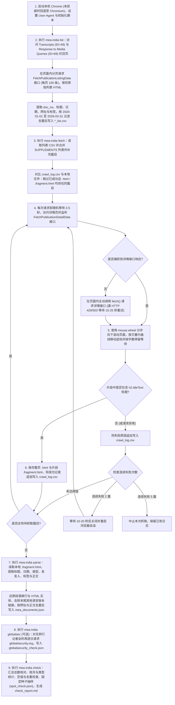

# MEA Spokesperson Crawler

基于 Playwright 的印度外交部官网（`www.mea.gov.in`）文本抓取与解析工具。程序抓取 `Transcripts`（记者会实录）和 `Response to Media Queries`（答记者问）两个栏目在 `2020-01-01` 至 `2026-03-31` 期间发布的全部英文文本，保存原始 HTML 文件，并将解析后的结构化数据输出为 JSON 文件。

> 本工具仅用于学术研究的数据采集，运行时请控制请求频率，避免对目标网站造成负担。

## 功能说明

### 运行逻辑与功能结构图



### 按运行顺序的功能说明

1. **启动本地浏览器与修改浏览器属性（`src/mea_india/browser.py`、`src/mea_india/stealth.py`）**
   - 默认优先查找并启动本机安装的 Google Chrome，未安装或启动失败时自动回退至 Playwright 内置 Chromium，并在终端打印实际启动的浏览器类型与版本号。
   - 启动时添加 `--disable-blink-features=AutomationControlled` 参数使 `navigator.webdriver` 保持为 `false`；提取实际运行浏览器的主版本号构造 `User-Agent`（`Chrome/<major>.0.0.0`），使其与 `Sec-CH-UA` 请求头一致。
   - 在浏览器上下文中设置 `Accept-Language: en-US,en;q=0.9`，并通过初始化脚本固定 `navigator.languages` 返回数组及处理 `Notification` 权限查询。
2. **分页抓取两个栏目的文章列表（`src/mea_india/lists.py`）**
   - 依次访问 `Transcripts`（`publicationId=49`）和 `Response to Media Queries`（`publicationId=69`）栏目页面建立同源会话。
   - 在页面内调用 `fetch()` 分页请求 `/FrontEnd/FetchPublicationListingData` 接口（每页 100 条，请求日期范围放宽为 `24/12/2019 - 07/04/2026`），将接口返回的每页原始 HTML 保存在 `mea_data/lists/raw/`。
   - 从列表中提取文章编号（`doc_no`）、标题、发布日期、详情页网址和标签，在本地按 `2020-01-01` 至 `2026-03-31` 过滤并按 `doc_no` 去重后，写入 `mea_data/lists/transcripts_list.csv` 和 `mea_data/lists/media_responses_list.csv`。
3. **读取本地断点与合并列表外补充篇目（`src/mea_india/details.py`）**
   - 读取两个栏目的列表 CSV，并合并 `SUPPLEMENTS` 中登记的列表外篇目（网站列表未收录但详情页存在的文章）。
   - 读取 `mea_data/crawl_log.csv` 中每篇文章最后一次抓取记录：若状态为成功且本地整页 `.html` 与片段 `.fragment.html` 文件均存在，则直接跳过；若传入 `--only-failed` 参数，则仅重新抓取日志中失败过的篇目。
4. **逐篇抓取详情页、模拟页面浏览与失败恢复（`src/mea_india/details.py`、`src/mea_india/stealth.py`）**
   - 单线程运行，每次请求前随机等待 2—5 秒。访问详情页网址并通过 `page.on("response", ...)` 监听后台 `/FrontEnd/FetchPublicationDetailData` 接口返回的 HTML 片段；若未捕获到该响应，则在页面内主动调用 `fetch()` 请求详情接口（当返回 HTTP 429 或 503 时等待 15—25 秒后重试一次）。
   - 页面加载后，通过 `page.mouse.wheel()` 分多次向下滚动页面（滚动间隙随机移动鼠标或小幅向上回滚），再将鼠标从当前停留坐标按三阶贝塞尔曲线分步移动至视口内的正文区域，并根据正文字数停留 0.5—1.8 秒。
   - 检查详情片段是否包含非空的 `h2.titleText` 标题：检查通过后将浏览器渲染后的整页 HTML（`.html`）与接口返回的详情片段（`.fragment.html`）写入 `mea_data/raw_html/`，并将抓取时间、状态与文件路径实时追加写入 `crawl_log.csv`。
   - 抓取过程中若连续 2 篇失败，程序等待 10—20 秒后关闭并重新启动浏览器会话；若连续 5 篇失败，则中止抓取并保留已有日志。
5. **离线解析 HTML 片段与正文清洗（`src/mea_india/parse.py`）**
   - 直接读取本地保存的 `.fragment.html` 文件（修改解析规则后无需重新访问网站），提取标题、发布日期、标题中的记者会日期、发言人姓名、标签和正文，并根据栏目与标题关键词划分文章类型（`weekly_briefing`、`special_briefing`、`other_briefing`、`media_response`）。
   - 遍历正文 DOM 节点：将块级标签与 `<br>` 转换为换行符，将不间断空格转换为普通空格并还原 HTML 实体字符，去除正文末尾指向其他语言版本 PDF 的链接（如 `Click here for Urdu version`），合并多余空行。
   - 按网址与正文内容检查去重后，按 `publication_date` 升序写入 `mea_data/mea_documents.json`。
6. **外部来源交叉核对与生成质量检查报告（`src/mea_india/globalsec.py`、`src/mea_india/check.py`）**
   - `globalsec`：扫描已解析数据中没有例行记者会（`weekly_briefing`）的周，按 `globalsecurity.org` 的转载网址规律逐日发送请求，记录状态码（`200` 存在转载、`404` 无此页或其他异常状态码）并保存至 `mea_data/globalsecurity_check.json`，用于排查官网列表漏收的篇目。
   - `check`：读取本地文件生成 `mea_data/check_report.md`，包含列表与解析总数核对、GlobalSecurity 交叉核对结果、2020-01 至 2026-03 按月统计、文章类型统计、空值检查、去重结果、非拉丁字符检查、按固定随机种子抽取的 10 篇人工核对表（结果保存在 `mea_data/spot_check.json`）以及失败与解析警告清单。

## 环境要求

- macOS / Linux / Windows
- Python 3.12 或更高版本（见 `.python-version`）
- [uv](https://docs.astral.sh/uv/)
- 本机已安装 Google Chrome（或使用 Playwright 内置 Chromium）

## 安装与配置

```bash
git clone git@github.com:TerraRiver/MEA_Spokesperson_Crawler.git
cd MEA_Spokesperson_Crawler
uv sync
```

如果本机未安装 Google Chrome，可安装 Playwright 内置 Chromium：

```bash
uv run playwright install chromium
```

## 运行与使用

所有命令默认以无头（Headless）模式运行浏览器。如需显示浏览器窗口，可添加 `--headed` 参数（例如 `uv run mea-india fetch --limit 2 --headed`）。

| 步骤 | 命令 | 输出文件 | 说明 |
| --- | --- | --- | --- |
| 1. 抓列表 | `uv run mea-india list` | `mea_data/lists/*_list.csv`<br>`mea_data/lists/raw/*.html` | 分页请求两个栏目的列表接口并按时间范围筛选 |
| 2. 抓详情 | `uv run mea-india fetch` | `mea_data/raw_html/`<br>`mea_data/crawl_log.csv` | 逐篇抓取详情页，自动跳过已成功且文件存在的篇目 |
| 3. 解析数据 | `uv run mea-india parse` | `mea_data/mea_documents.json` | 离线解析本地 `.fragment.html` 并去重输出 JSON |
| 4. 外部核对（可选） | `uv run mea-india globalsec` | `mea_data/globalsecurity_check.json` | 对无例行记者会的周逐日请求 GlobalSecurity 核对 |
| 5. 质量检查 | `uv run mea-india check` | `mea_data/check_report.md` | 汇总各项统计与核对结果生成检查报告 |

`fetch` 子命令支持的可选参数：
- `uv run mea-india fetch --limit 10`：每个栏目仅抓取发布日期最新的 10 篇（用于小批量测试）。
- `uv run mea-india fetch --only-failed`：仅重新抓取 `crawl_log.csv` 中最后一次状态为失败的篇目。

### 输出 JSON 结构说明（`mea_documents.json`）

`mea_documents.json` 为 UTF-8 编码的 JSON 数组，按 `publication_date` 升序排列：

```json
[
  {
    "id": "mea_transcripts_38297",
    "section": "transcripts",
    "doc_type": "weekly_briefing",
    "title": "Transcript of Weekly Media Briefing by the Official Spokesperson (September 12, 2024)",
    "publication_date": "2024-09-12",
    "briefing_date": "2024-09-12",
    "url": "https://www.mea.gov.in/media-briefings?dtl/38297/Transcript_of_Weekly_Media_Briefing_by_the_Official_Spokesperson_September_12_2024",
    "tags": [
      "Official Spokesperson",
      "Media Briefing"
    ],
    "spokesperson": "Randhir Jaiswal",
    "content": "Shri Randhir Jaiswal, Official Spokesperson: Good afternoon friends...",
    "raw_file": "raw_html/transcripts/transcript_2024-09-12_38297.html",
    "raw_fragment_file": "raw_html/transcripts/transcript_2024-09-12_38297.fragment.html",
    "crawl_time": "2026-10-12 16:05:12",
    "source": "site_list"
  }
]
```

字段含义：

| 字段 | 类型 | 说明 |
| --- | --- | --- |
| `id` | 字符串 | 唯一编号，格式为 `mea_{section}_{网站编号}`，如 `mea_transcripts_38297`、`mea_media_responses_34982` |
| `section` | 字符串 | 所属栏目：`transcripts` 或 `media_responses` |
| `doc_type` | 字符串 | 文本类型，取值规则见下表 |
| `title` | 字符串 | 详情页标题，原样保留 |
| `publication_date` | 字符串 | 页面显示的发布日期（`.date`），格式 `YYYY-MM-DD` |
| `briefing_date` | 字符串或 `null` | 仅 `transcripts` 栏目：从标题中提取的最后一个日期（如 `(January 30, 2020)`、`(11th December 2020)`、`…on 14 August 2020`），格式 `YYYY-MM-DD`；标题不含日期或属于 `media_responses` 栏目时为 `null` |
| `url` | 字符串 | 详情页完整网址 |
| `tags` | 字符串列表 | 页面上的标签列表，无标签时为空列表 `[]` |
| `spokesperson` | 字符串或 `null` | 发言人姓名（去除 `Shri`/`Sh.`/`Mr.`/`Dr.` 称谓），从正文中第一处标明发言人身份的表述（如 `Shri ..., Official Spokesperson`、`Official Spokesperson Shri ...`、`Official Spokesperson, ...`、`MEA Spokesperson ...`）提取；正文未出现姓名时为 `null` |
| `content` | 字符串 | 清洗后的正文文本 |
| `raw_file` | 字符串 | 整页原始 HTML 文件相对于 `mea_data/` 的路径 |
| `raw_fragment_file` | 字符串 | 详情接口 HTML 片段文件相对于 `mea_data/` 的路径 |
| `crawl_time` | 字符串 | 抓取时间，格式 `YYYY-MM-DD HH:MM:SS` |
| `source` | 字符串 | 篇目来源：`site_list`（网站栏目列表中的篇目）或 `supplement`（列表外补充篇目） |

`doc_type` 取值与判断规则（不区分大小写，按顺序匹配）：

| 取值 | 判断规则 |
| --- | --- |
| `weekly_briefing` | `transcripts` 栏目中标题包含 `Weekly Media Briefing`（含 `Virtual Weekly Media Briefing`、`Bi-weekly Media Briefing`） |
| `special_briefing` | `transcripts` 栏目中标题匹配正则 `special.*briefing`（如 `Special Briefing`、`Special Media Briefing`、`Special Virtual Briefing`） |
| `other_briefing` | `transcripts` 栏目中不符合以上两条的其他文本 |
| `media_response` | `media_responses` 栏目的全部文本 |

### 正文清洗规则

- **去除的内容**：
  - 网页导航栏、菜单、页眉页脚、侧边栏、分享按钮等非正文元素；
  - HTML 标签与脚本，并将 HTML 实体（如 `&amp;`、`&nbsp;`）还原为普通字符；
  - 行首行尾多余空白，并将连续空行合并为单个换行；
  - 正文末尾指向其他语言版本 PDF 的链接（文字格式为 `Click here for Xxx version` 且 `href` 以 `.pdf` 结尾的链接及其后的 PDF 图标；紧邻其前的落款如 `New Delhi` 和日期行予以保留）。
- **保留的内容**：
  - 段落分隔（块级标签与 `<br>` 转换为换行符 `\n`）；
  - 说话人标识（如 `Shri Randhir Jaiswal, Official Spokesperson:`、`Sidhant:`）；
  - 正文中以拉丁字母拼写的印地语问答及方括号内的 `Approximate Translation` 英文翻译；
  - 原文中的拼写、标点及字符缺失（如部分 2020 年实录源码中缺失撇号的 `Ill`、`weve`），不做字符替换或修正。

## 印度外交部网站结构与抓取规则说明（记录于 2026-10-12）

### 1. 栏目与抓取范围

| 栏目名称 | 网站导航路径 | 页面路径 | 接口 `publicationId` | 内容说明 |
| --- | --- | --- | --- | --- |
| Transcripts（记者会实录） | Media → Media Briefings → Transcripts | `/media-briefings?51/Transcripts` | `49` | 外交部发言人例行记者会、线上记者会、专题吹风会文字实录 |
| Response to Media Queries（答记者问） | Media → Media Releases → Response to Media Queries | `/response-to-queries?69/Media_Queries` | `69` | 发言人针对具体事件发布的书面回应 |

抓取筛选规则：
- **时间范围**：按页面发布日期（`.date`）筛选 `2020-01-01` 至 `2026-03-31`（两端包含）。
- **全量抓取**：不使用网站上的标签（Tags）或标题筛选，两个栏目在时间范围内的全部篇目均抓取。
- **语言参数**：列表和详情接口统一传入英文参数（`PLngId=1` / `languageId=1`）。

### 2. 后台接口格式

网站列表和详情正文均由后台接口返回 HTML 片段动态加载：

| 用途 | 接口路径与参数 | 返回结构说明 |
| --- | --- | --- |
| 列表接口 | `/FrontEnd/FetchPublicationListingData?publicationId={ID}&KeywordName=&SortBy=new&page={N}&PageSize=100&DateRange={起} - {止}&IsInternalMEA=false&PLngId=1` | 每条记录位于 `.pressRelesastBox`：日期为 `.date`，标题与链接为 `.pressTitle a`，标签为 `.tags a`；总条数位于 `.paginationBox` 的 `Displaying Item x To y of N` |
| 详情接口 | `/FrontEnd/FetchPublicationDetailData?pkid={网站编号}&languageId=1` | 包含日期 `.date`、标题 `h2.titleText`、正文 `.description` 和标签 `.tags a` |

- `DateRange` 参数仅接受 `dd/mm/yyyy - dd/mm/yyyy` 格式。抓取列表时将请求范围前后各放宽约一周（`24/12/2019 - 07/04/2026`），拿到数据后再在本地按 `2020-01-01` 至 `2026-03-31` 过滤。
- 详情页网址格式为 `https://www.mea.gov.in/media-briefings?dtl/{编号}/{标题slug}` 和 `https://www.mea.gov.in/response-to-queries?dtl/{编号}/{标题slug}`。

### 3. 列表外篇目说明

网站上存在详情页可直接访问、但未出现在栏目列表中的文章。经与 `globalsecurity.org` 转载记录交叉核对，已确认 2 篇列表外例行记者会（两篇在网站上的标签均为空）：
- `40219`：`2025-10-16` 例行记者会（`Transcript of Weekly Media Briefing by the Official Spokesperson (October 16, 2025)`）
- `40245`：`2025-10-30` 例行记者会（`Transcript of Weekly Media Briefing by the Official Spokesperson (October 30, 2025)`）

这类篇目登记在 `src/mea_india/lists.py` 的 `SUPPLEMENTS` 字典中，抓取与解析流程与列表篇目一致，输出 JSON 中以 `source: "supplement"` 标识（栏目列表 CSV 仍只保存网站列表接口原样返回的内容）。

## 项目结构

```text
.
├── pyproject.toml           # 项目配置与依赖声明
├── uv.lock                  # 依赖版本锁定文件
├── README.md                # 项目说明文档
├── USAGE.md                 # 命令速查说明
├── src/mea_india/
│   ├── __init__.py          # CLI 命令行入口
│   ├── config.py            # 路径、栏目编号、时间范围与接口地址定义
│   ├── stealth.py           # 浏览器属性修改与鼠标移动、滚轮滚动模拟
│   ├── browser.py           # Playwright 浏览器会话封装、限速与接口响应获取
│   ├── lists.py             # 列表分页抓取、CSV 读写与列表外补充篇目管理
│   ├── details.py           # 详情页抓取、日志记录与断点续爬
│   ├── parse.py             # 本地 HTML 片段清洗、字段提取与去重
│   ├── globalsec.py         # GlobalSecurity.org 转载页面探测核对
│   └── check.py             # 质量检查报告生成
└── mea_data/
    ├── raw_html/
    │   ├── transcripts/     # 实录整页 *.html 与详情片段 *.fragment.html
    │   └── media_responses/ # 答记者问整页 *.html 与详情片段 *.fragment.html
    ├── lists/
    │   ├── raw/             # 列表接口返回的原始分页 HTML
    │   ├── transcripts_list.csv
    │   └── media_responses_list.csv
    ├── mea_documents.json   # 解析去重后的结构化数据
    ├── crawl_log.csv        # 详情页抓取日志
    ├── globalsecurity_check.json # GlobalSecurity 探测结果
    ├── spot_check.json      # 随机 10 篇人工抽查核对记录
    └── check_report.md      # 质量检查报告
```

## 当前数据与质检结果（截至 2026-11-06）

- **抓取与入库数量**：共 682 篇（`transcripts` 栏目 460 篇，含列表 458 篇与列表外补充 2 篇；`media_responses` 栏目 222 篇），全部抓取成功，无失败记录，无重复记录，无空正文篇目。
- **类型分布**：`weekly_briefing` 188 篇、`special_briefing` 243 篇、`other_briefing` 29 篇、`media_response` 222 篇。
- **已知数据特点**：
  - 例行记者会为 0 篇的月份：`2020-04`（疫情期间暂停线下例行记者会，5 月起改为线上）、`2023-05`（当月仅发布专题吹风会）。
  - `spokesperson` 为 `null` 的篇目共 66 篇，原因是原文仅写 `Official Spokesperson said` 而未出现发言人姓名，或属于外交秘书等其他官员主持的专题吹风会。
  - `briefing_date` 为 `null` 的 `transcripts` 篇目共 20 篇，原因是原页面标题中未附带日期。
  - 有 7 篇实录（如 2025 年 5 月的 5 篇 `OPERATION SINDOOR` 吹风会）英文页面正文中包含少量直接以天城文记录的印地语问答段落，按原样保留。
- **详细质检数据**：见 [mea_data/check_report.md](mea_data/check_report.md)。
